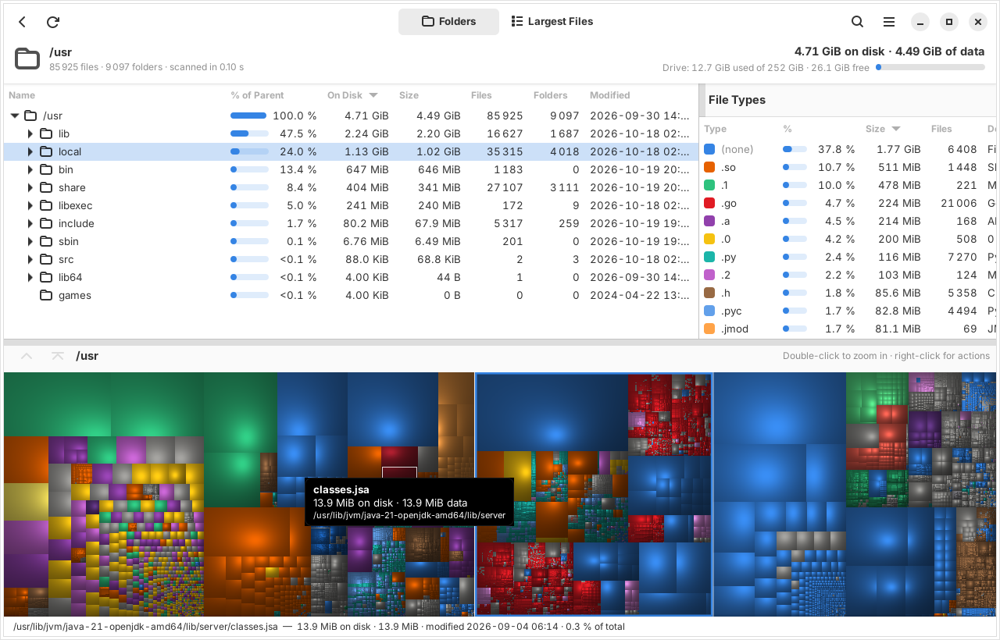
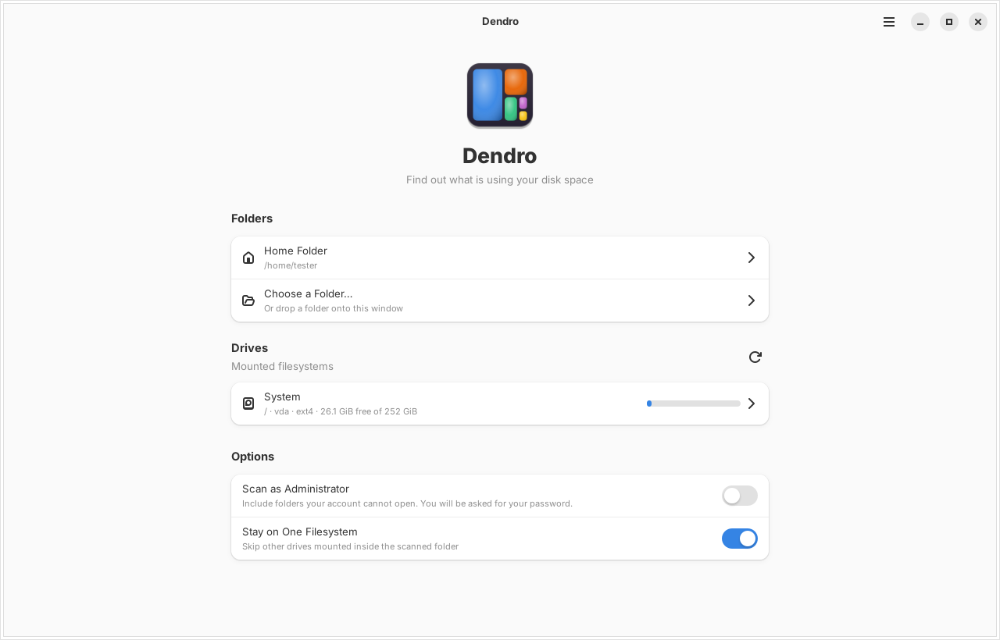
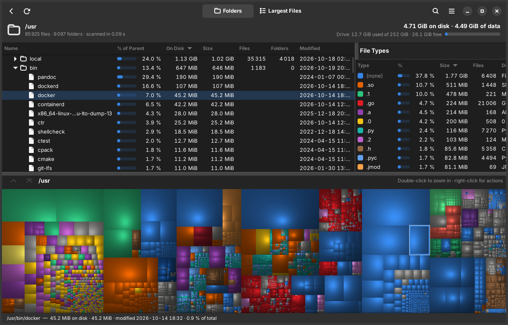
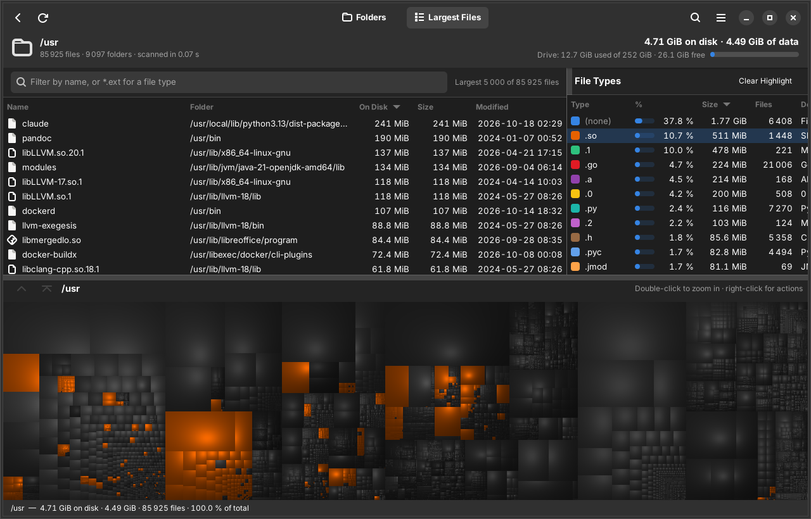

<p align="center">
  
</p>

<h1 align="center">Dendro</h1>

<p align="center"><b>A fast, WizTree-style disk space analyzer for Linux.</b><br>
See at a glance which folders, files and file types are eating your disk.</p>



Dendro scans a drive or folder in parallel and shows the result four ways at
once, like WizTree does on Windows:

- a **folder tree** sorted by size, with *% of parent* bars, file and folder counts;
- the **largest files** anywhere in the scan, with instant name / `*.ext` search;
- a **file type** breakdown, where clicking a type lights up all those files in the treemap;
- a **cushion treemap**, where every rectangle is a file and its area is its size.

From any of these you can open an item, show it in your file manager, copy its
path, move it to the trash or delete it permanently.

## Features

- **Fast.** Directories are read with raw `getdents64` and every entry is
  examined with a single `statx` relative to its parent folder, on all CPU cores
  at once. On a 4-core machine Dendro scans a million files in about one
  second, roughly 2–3× faster than `du`.
- **Every file, including hidden ones.** Nothing is filtered: dot-files and
  dot-folders are counted and shown (dimmed, like in file managers).
- **Accurate.** Hard links are counted once, symlinks are never followed,
  and both the *size on disk* (allocated blocks) and the *file size* are shown.
  Folders that couldn't be read are flagged and listed.
- **Works on every filesystem** the Linux kernel can mount: ext4, btrfs (incl.
  subvolumes), xfs, zfs, f2fs, bcachefs, ntfs3 / ntfs-3g, exfat, vfat, NFS,
  SMB/CIFS, sshfs and more. Virtual filesystems (`/proc`, `/sys`, …) are always
  skipped, and by default the scan stays on one filesystem.
- **Scan as administrator** (optional) to include folders your account can't
  open. Only a small read-only helper runs as root; the window never does.
- **Modern GTK 4 / libadwaita interface** that follows your system's light/dark
  style and accent colour, works on Wayland and X11 and scales on HiDPI screens.
- **Compact in memory**: 56 bytes per file or folder plus its name, so even
  millions of files fit comfortably.

| Light | Dark |
| --- | --- |
|  |  |



## Installation

Dendro is built from source. The included script installs everything that is
needed, builds Dendro and installs it so it shows up in your application menu.

### Requirements

| | Minimum | Already included in |
| --- | --- | --- |
| GTK | 4.12 | Arch, Manjaro, EndeavourOS, Fedora 40+, Ubuntu 24.04+, Debian 13+, Linux Mint 22+, Pop!_OS 24.04+, openSUSE Tumbleweed / Leap 16 |
| libadwaita | 1.5 | same as above |
| Rust | 1.85 | installed automatically with [rustup](https://rustup.rs) if your distribution's is older |

Ubuntu 22.04, Debian 12 and older releases ship a GTK/libadwaita that is too old.

### Arch Linux (and Manjaro, EndeavourOS, CachyOS, …)

```sh
sudo pacman -S --needed git base-devel
git clone https://github.com/oreo1298/WizTreeLinux.git
cd WizTreeLinux
./install.sh
```

On Arch the script builds a normal **pacman package** from
[`packaging/arch/PKGBUILD`](packaging/arch/PKGBUILD) and installs it with
pacman, so pacman knows about every file. If you prefer doing it by hand, this
is all the script does:

```sh
cd WizTreeLinux/packaging/arch
makepkg -si
```

**Update:**

```sh
cd WizTreeLinux
./install.sh update
```

(or by hand: `git pull`, then `makepkg -si` in `packaging/arch`)

**Uninstall:**

```sh
./install.sh uninstall
```

(or by hand: `sudo pacman -R dendro`, and optionally `rm -rf ~/.config/dendro`
to remove your settings)

### Debian, Ubuntu, Linux Mint, Pop!_OS, elementary OS, Zorin OS

```sh
sudo apt install git
git clone https://github.com/oreo1298/WizTreeLinux.git
cd WizTreeLinux
./install.sh
```

The script installs the build dependencies with apt, installs Rust with rustup
if the system's Rust is too old, builds Dendro and installs it to `/usr/local`.

### Fedora, openSUSE, Void, Alpine, Gentoo

Same as above — install `git` with your package manager
(`sudo dnf install git`, `sudo zypper install git`, …), clone the repository
and run `./install.sh`. The script knows the right packages for `dnf`,
`zypper`, `xbps`, `apk` and `emerge`.

### Updating and uninstalling (all distributions)

```sh
cd WizTreeLinux
./install.sh update       # pull the latest version and reinstall it the same way
./install.sh uninstall    # remove Dendro (asks whether to delete your settings too)
```

### Script options

```text
./install.sh [install|update|uninstall] [options]

  --user          install for your user only (~/.local), no sudo for the install step
  --prefix DIR    install somewhere else than /usr/local
  --no-package    on Arch-based systems, use `make install` instead of a pacman package
  --no-deps       don't install build dependencies
  -y, --yes       don't ask for confirmation
```

### Manual build

If you'd rather do everything yourself, install the GTK 4 and libadwaita
development packages, `pkg-config`, a C compiler and Rust ≥ 1.85, then:

| Distribution | Build dependencies |
| --- | --- |
| Arch | `sudo pacman -S --needed base-devel gtk4 libadwaita rust` |
| Debian / Ubuntu | `sudo apt install build-essential pkg-config libgtk-4-dev libadwaita-1-dev` (+ Rust from [rustup](https://rustup.rs)) |
| Fedora | `sudo dnf install gcc make pkgconf-pkg-config gtk4-devel libadwaita-devel cargo` |
| openSUSE | `sudo zypper install gcc make pkgconf gtk4-devel libadwaita-devel cargo` |

```sh
make                          # build (as your normal user)
sudo make install             # install to /usr/local
sudo make uninstall           # remove again

make install PREFIX=~/.local  # or: install just for you, without sudo
make uninstall PREFIX=~/.local
```

To try it without installing: `cargo run --release -- ~/Downloads`.

## Using Dendro

Start **Dendro** from your application menu, or run `dendro` in a terminal
(`dendro /some/folder` starts scanning that folder right away, and
`dendro --new-window` opens another window). Pick a drive,
your home folder or any other folder — you can also drop a folder onto the
window.

- **Folder tree** (top left): expand folders to drill down. Click a column
  header to sort by it. Double-click or press <kbd>Enter</kbd> to expand.
- **Largest Files** (switch at the top): the 5000 largest files of the scan.
  Type in the search field to filter by name, or `*.mp4` for a file type.
  Double-click a file to reveal it in the folder tree.
- **File Types** (top right): click a type to highlight its files in the
  treemap; double-click it to list the largest files of that type.
- **Treemap** (bottom): hover for details, click to select the item in the
  folder tree, double-click to zoom into a folder, right-click for actions.
  The ↑ button (or the mouse's back button) zooms out again.

Right-click anything for **Open**, **Open Containing Folder**, **Copy Path**,
**Move to Trash** and **Delete Permanently**. Deleting never reaches into other
drives: a folder with a drive or network share mounted inside it is left alone
(unmount it first), and permanent deletion stops at any mount point it meets.

### Keyboard shortcuts

| Shortcut | Action |
| --- | --- |
| <kbd>Ctrl</kbd>+<kbd>O</kbd> | Scan a folder |
| <kbd>F5</kbd> / <kbd>Ctrl</kbd>+<kbd>R</kbd> | Scan again |
| <kbd>Ctrl</kbd>+<kbd>N</kbd> | Back to the drive list |
| <kbd>Ctrl</kbd>+<kbd>F</kbd> | Search files |
| <kbd>Ctrl</kbd>+<kbd>Enter</kbd> | Open the selected item |
| <kbd>Ctrl</kbd>+<kbd>Shift</kbd>+<kbd>Enter</kbd> | Show the selected item in its folder |
| <kbd>Ctrl</kbd>+<kbd>C</kbd> | Copy the selected item's path |
| <kbd>Delete</kbd> | Move the selected item to the trash |
| <kbd>Shift</kbd>+<kbd>Delete</kbd> | Delete the selected item permanently |
| <kbd>Ctrl</kbd>+<kbd>,</kbd> | Preferences |
| <kbd>Ctrl</kbd>+<kbd>?</kbd> | All keyboard shortcuts |
| <kbd>Ctrl</kbd>+<kbd>Shift</kbd>+<kbd>N</kbd> | New window |
| <kbd>Ctrl</kbd>+<kbd>W</kbd> / <kbd>Ctrl</kbd>+<kbd>Q</kbd> | Close window / quit |

### Preferences

- **Style**: follow the system, or always light / dark.
- **Treemap style**: shaded cushions (like WizTree and WinDirStat) or flat.
- **Measure by**: *space on disk* (what you get back by deleting) or *file
  size*. Used for sorting, percentages and the treemap.
- **Units**: binary (KiB, MiB, GiB) or decimal (kB, MB, GB).
- **Stay on one filesystem** and the number of **worker threads**.

Settings are stored in `~/.config/dendro/settings.conf`.

### Scanning as administrator

Folders such as `/root`, `/var/lib/…` or other users' homes can't be read by
your account, so their size would be missing. Turn on **Scan as Administrator**
on the start page (or use *Scan Again as Administrator* from the menu, or the
*Details* button on the warning bar). Dendro then asks for your password through
polkit and runs a small, read-only helper (`dendro --scan-helper`) as root that
streams the results back to the window. The window itself always runs as your
normal user.

This needs `pkexec` (part of polkit) and a running polkit authentication agent.
GNOME, KDE Plasma, Xfce, Cinnamon, MATE, Budgie and LXQt all start one
automatically. On a bare window manager (i3, Sway, Hyprland, …) start one
yourself, e.g. `polkit-gnome`, `lxqt-policykit` or `hyprpolkitagent`.

## How it works

- **Scanner** (`src/scanner.rs`): each directory is opened relative to its
  parent's file descriptor (`openat`), read in 64 KiB batches with
  `getdents64`, and every entry gets one `statx` call with
  `AT_SYMLINK_NOFOLLOW | AT_NO_AUTOMOUNT | AT_STATX_DONT_SYNC` — no path
  lookups, no automount storms, no network round trips to revalidate
  attributes. Subdirectories are processed on a work-stealing thread pool
  (2 threads per CPU, which keeps the disk queue full on cold caches). Mount
  points are detected with `STATX_ATTR_MOUNT_ROOT`, so btrfs subvolumes are
  scanned while real mounts are not crossed unless you ask for it.
- **Tree** (`src/tree.rs`): results end up in one flat array of 56-byte nodes
  plus one buffer for all names, with each folder's children stored next to
  each other, sorted by size.
- **Treemap** (`src/treemap.rs`): squarified layout and per-pixel cushion
  shading, rendered on a background thread together with a pixel → item index
  so hovering and clicking are instant.

Measured in a 4-core VM with a warm cache:

| Scan | `du -s` | Dendro |
| --- | --- | --- |
| `/` (228 000 files) | 0.51 s | 0.21 s |
| synthetic tree, 1 000 000 files | 2.56 s | 0.99 s |

## Troubleshooting

**`./install.sh` says my GTK or libadwaita is too old.** Your distribution
release is older than the ones listed under *Requirements*. Upgrade the
distribution, or use a newer one.

**The dark style isn't picked up on KDE Plasma / other desktops.** libadwaita
reads the light/dark preference (and, with libadwaita 1.6+, the accent colour)
from the *XDG desktop portal*. Make sure `xdg-desktop-portal` and the portal
for your desktop are installed (`xdg-desktop-portal-kde`,
`xdg-desktop-portal-gnome` or `xdg-desktop-portal-gtk`). You can also pick
Light or Dark in Preferences.

**"Scan as Administrator" fails with "Not authorized" or nothing happens.** No
polkit authentication agent is running — see
[Scanning as administrator](#scanning-as-administrator).

**Some numbers differ from `du`.** By default Dendro stays on one filesystem
(like `du -x`), counts hard links once (like `du`) and shows the space on disk.
`du --apparent-size` corresponds to *Measure by: File Size*.

**btrfs snapshots are counted several times.** Snapshots that are not mounted
separately are ordinary folders to every tool, so their files are counted per
snapshot (they share data on disk). Scan the subvolume you're interested in, or
mount snapshots elsewhere.

## Development

```sh
cargo run -- /usr        # debug build, scans /usr on start
cargo test               # unit tests (scanner, tree, treemap, helper, …)
cargo clippy --all-targets
```

Code layout: `src/scanner.rs`, `src/tree.rs`, `src/treemap.rs`,
`src/helper.rs` and `src/mounts.rs` are independent of GTK; the user interface
lives in `src/ui/`.

## License

MIT — see [LICENSE](LICENSE).

Dendro (Greek *déndron*, "tree") is inspired by
[WizTree](https://diskanalyzer.com/), WinDirStat and SequoiaView. It is an
independent project and not affiliated with or endorsed by Antibody Software,
the makers of WizTree.
